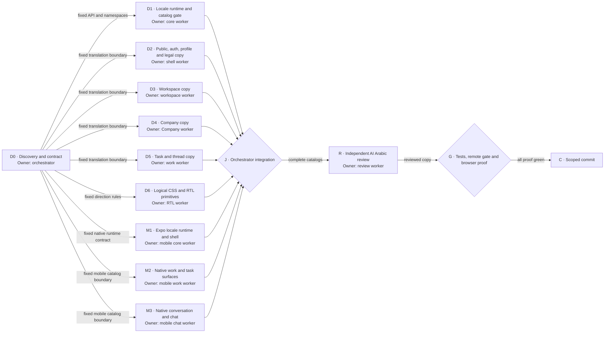

# Arabic internationalization and right-to-left support

Status: approved for implementation, expanded to Expo mobile on 2026-08-12.

## Background

Track's web and Expo apps currently render one English interface. User-facing
text lives inside routes, features, browser and native notifications, and
formatting helpers. The web root fixes `lang="en"`; Expo headers and back labels
are English; neither app has a locale registry or catalogs; dates and numbers use
mixed device defaults; and both clients contain physical left and right layout.

The desired state is a web, PWA, iOS, and Android interface that a person can use
in English or Modern Standard Arabic. Each client remembers the selected language
locally without an account write. Arabic selects right-to-left layout as one
derived locale property, while user content and technical values keep their
natural direction. English and Arabic catalogs ship in the Git revision and need
no translation service at run time.

## Done

The release is complete when all of these checks are observable:

- A language control offers `English` and `العربية` in each language's own name.
- A saved selection survives reloads in the same browser, synchronizes between
  open tabs, and survives native app restarts on the same device. Denied or
  unavailable storage leaves each app usable.
- A fresh install uses the first supported browser or device language and
  otherwise English.
- The root element is `lang="en" dir="ltr"` for English and
  `lang="ar" dir="rtl"` for Arabic. Direction is not stored separately.
- English and Arabic UI chrome, metadata, auth, profile, workspace, Company,
  Project, Channel, thread, task, settings, search, notification, PWA, and public
  legal/support surfaces come from bundled catalogs.
- Arabic copy is Modern Standard Arabic. Track, Company and product proper names
  remain stable where translation would change identity.
- Arabic presentation uses the same digit policy as Ava:
  `ar-u-nu-latn`, which keeps the `0–9` glyphs while using Arabic language rules.
- Dates, times, relative labels, counts, percentages, and file sizes use the active
  formatter locale. Machine values such as URL parts, ISO input values, IDs, and
  storage keys never change with display locale.
- Main shell, dialogs, menus, drawers, task boards, threads, forms, and narrow PWA
  layouts mirror without clipping, overlap, or reversed interaction meaning.
- Expo headers, back affordances, gestures, sheets, safe areas, keyboards,
  conversation, Company, task, thread, profile, auth, and notification surfaces
  mirror on iOS and Android after a direction-changing locale switch.
- Email addresses, URLs, mentions, Channel references, task keys, file names, code,
  and IDs remain readable as left-to-right islands. User-authored and model text
  uses natural direction instead of forced translation.
- English and Arabic catalogs have identical namespace, key, interpolation, and
  plural shapes. Empty strings and missing-key sentinels fail the catalog gate.
- An independent AI review checks all Arabic catalog values. Human or native-speaker
  approval is not a release gate.
- The repository gate passes, the web app is loaded on `localhost`, English and
  Arabic flows are checked in a browser, and native English and Arabic flows are
  checked on iOS and Android with no new console or device errors.

## Deliberate limits

- Track does not add account-synced language preferences, a database field, a
  Convex function, or a translation management service.
- This release supports generic `ar`, not a country dialect. Future `ar-SA` and
  `ar-AE` are separate switcher languages with separate catalogs and metadata.
- User-authored content, imported memory, assistant answers, evidence, names,
  filenames, URLs, and arbitrary server error text are not translated.
- This release does not rewrite legal meaning. Arabic web legal copy must preserve
  the English contract and version date.
- Human language verification is not required. Product and functional browser
  checks still remain required.

## Settled decisions

### Locale registry

One typed registry is authoritative for every supported locale:

| Locale | Self-name | Direction | Formatter locale | State |
| --- | --- | --- | --- | --- |
| `en` | English | `ltr` | `en-US` | Shipped |
| `ar` | العربية | `rtl` | `ar-u-nu-latn` | Shipped |
| `ar-SA` | العربية (السعودية) | `rtl` | To be decided with its release | Reserved, not accepted as a saved switcher value |
| `ar-AE` | العربية (الإمارات) | `rtl` | To be decided with its release | Reserved, not accepted as a saved switcher value |

The current browser matcher may map an unsaved browser language such as `ar-SA`
or `ar-AE` to generic `ar`. Once either locale ships, exact matching must win and
the locale gets its own switcher entry and catalog. A stored locale accepts only a
current canonical switcher value.

Direction, formatter locale, and self-name are derived from the selected locale.
They are never independent preferences.

### Catalog ownership

English and Arabic catalogs are source files committed beside the web runtime.
The built application bundles them eagerly. Production performs no catalog fetch
and carries no translation-service token, backend, or network fallback.

English is the source catalog. Arabic must match its namespaces and keys exactly.
The catalog gate rejects:

- a missing or extra namespace or key;
- empty or non-string leaf values;
- mismatched interpolation variables;
- mismatched plural forms;
- missing-key sentinel text;
- a translated call with an English default that can hide a missing key.

New visible UI copy enters the English catalog in the same change. A small,
reviewed exemption list may cover product names, technical tokens, test fixtures,
and user-content render points. It cannot become a general escape hatch.

### Locale resolution and persistence

The web app resolves its first locale in this order:

1. A canonical saved value under `track:locale:v1`.
2. The first supported entry in `navigator.languages`, with regional Arabic tags
   mapped to generic `ar` for this release.
3. English.

The server-rendered shell is English because local storage is not available on
the server. A small inline script applies the resolved root `lang` and `dir`
before paint. React hydrates from the stable English server state, then adopts
the resolved browser locale after mount without a hydration error. A saved value
changed in another tab updates the open app through the storage event.

Storage access is wrapped in safe reads and writes. Privacy mode, quota failure,
or a disabled storage API must not block rendering or language switching for the
current tab.

The Expo app resolves its first locale in this order:

1. A canonical device-local value under `track.locale.v1`, stored through the
   existing platform storage adapter. The native key uses dots because Expo
   SecureStore rejects the colon used by the web local-storage key.
2. The first supported `expo-localization` device language, with regional Arabic
   tags mapped to generic `ar` for this release.
3. English.

Expo declares `en` and `ar` as supported locales and enables RTL support in app
configuration. A locale provider loads before the routed app. When a native
switch changes between `ltr` and `rtl`, it saves the locale, applies
`I18nManager.allowRTL` and `I18nManager.forceRTL`, and reloads the app once through
Expo's built-in `reloadAppAsync`. The provider compares desired and active native
direction before reloading. Startup reapplies a mismatched native direction flag
without requesting a second reload, so runtimes such as Expo Go that ignore
`forceRTL` cannot enter a reload loop. A same-direction locale change does not
need a native reload.

### Arabic language and review

Arabic catalogs use Modern Standard Arabic, direct interface verbs, and consistent
product terms. The glossary is part of the implementation and keeps the same term
for each core noun. Placeholders, plural variables, punctuation, digit policy,
proper names, and access language must retain their meaning.

After implementation, an independent AI reviewer examines Arabic values without
editing component logic or English source text. The review records the input
commit, model, prompt revision, namespace/key counts, findings, and applied copy
changes. A second human or native-speaker review is not required.

## Canonical language

- **Locale**: one selectable language contract, such as `en` or `ar`.
- **Catalog**: Git-owned UI strings for one locale and namespace.
- **Modern Standard Arabic (MSA)**: the shared formal Arabic used by this release.
- **UI chrome**: product-owned labels, controls, notices, errors, and help copy.
- **User content**: names, messages, tasks, evidence, files, imported memory, and
  assistant output supplied by a person or another system.
- **Technical token**: an email, URL, mention, Channel reference, task key, ID,
  code fragment, file name, or machine value whose characters must stay stable.
- **Direction**: `ltr` or `rtl`, derived only from locale metadata.
- **Natural direction**: browser bidirectional rendering selected from the text
  itself, normally through `dir="auto"` and Unicode isolation.

Core Arabic glossary:

| English | Arabic |
| --- | --- |
| Company | الشركة |
| Project | المشروع |
| Channel | القناة |
| Conversation | المحادثة |
| Thread | سلسلة المحادثة |
| Task | المهمة |
| Board | اللوحة |
| Reference | المرجع |
| Evidence | الدليل |
| Memory | الذاكرة |
| Assistant | المساعد |
| Settings | الإعدادات |

`Track` and `@track` remain product identities. The Arabic sentence around them
may change, but the identity string does not.

## Behavior

### Language control

The authenticated web app places one compact language control with the existing
account and theme controls in the workspace sidebar. Public, auth, profile, and
legal pages expose the same reusable web control where the workspace sidebar is
not present. Expo exposes its reusable control on sign-in and in the Projects
account sheet beside Appearance. The control has a visible label and accessible
name, shows languages in their self-names, and does not use flags.

Changing the value updates catalog text, language and direction, formatters, and
the local preference as one operation. Web changes in place. Native reloads only
when direction changes; its controls live outside composers so the reload cannot
discard unsent conversation text. Auth credentials remain device-local and
survive the reload.

### Formatting

Shared helpers own date, time, relative time, number, percent, currency, duration,
and file-size presentation. Callers supply the active locale. Fixed local-date
keys used in queries and form inputs remain `YYYY-MM-DD` and must not pass through
a display formatter.

English may use English relative words such as Today and Yesterday. Arabic uses
the matching catalog or `Intl.RelativeTimeFormat` output. Both locales keep the
Western `0–9` digit glyphs required by `ar-u-nu-latn`.

### User content and errors

UI chrome follows the app direction. User content uses natural direction.
Technical tokens use isolated left-to-right spans so surrounding Arabic cannot
reorder punctuation or identifiers.

The client translates stable error states, not arbitrary exception messages.
Raw server, provider, or user text remains data and must not become a catalog key.
When no stable code exists, the UI shows a localized safe fallback and may keep
diagnostic detail outside the user-facing sentence.

### Failure and offline behavior

| Condition | Required result |
| --- | --- |
| Local storage read fails | Resolve from browser languages, then English |
| Local storage write fails | Keep the selected locale for the current tab |
| Saved value is invalid | Ignore it and use browser resolution |
| Catalog key is missing in development/test | Render an obvious missing-key sentinel and fail the catalog gate |
| Catalog key is missing in production | Use the English key only as a safe fallback and report the defect |
| Browser has no supported language | Use English and left-to-right layout |
| Mixed Arabic and technical text | Keep UI RTL and isolate the technical token or natural content |
| App is offline | Both bundled languages and switching continue to work |

## System boundaries

`apps/web/src/i18n` owns web locale metadata, safe persistence, catalog resources,
the React runtime, formatters, the language control, glossary, and focused tests.
`apps/web/scripts` owns static catalog and source checks. Feature files consume
translation hooks and formatting helpers. `apps/web/src/styles.css` and the UI
primitives own direction-safe layout.

`apps/mobile/src/i18n` owns native bundled catalogs and translation setup.
`apps/mobile/src/contexts/locale-context.tsx` owns device locale state,
persistence, derived direction, and the direction-change reload. Native feature
files consume that context and locale-aware formatters. Each mobile file owns its
direction-safe React Native styles because those styles are colocated with the
component.

`packages/shared` and `convex` gain no framework import or locale state. Convex
stores no language preference. Generated route and Convex files are never
hand-edited.

The call path is:

```text
root before-paint script
  -> locale registry and browser preference
  -> root lang and dir
  -> locale provider and bundled catalogs
  -> feature translation hooks and shared formatters
  -> language control changes locale and safe browser storage

Expo root locale provider
  -> saved device value or expo-localization device language
  -> bundled native catalogs and locale formatters
  -> derived I18nManager direction and one reload when direction changes
  -> routed native features and device-local language control
```

## RTL design rules

- Prefer logical CSS properties such as `margin-inline-start`, `padding-inline`,
  `border-inline-end`, `inset-inline-start`, and `text-align: start`.
- Do not apply a global `row-reverse`, transform, or icon-mirroring rule.
- Mirror navigation placement, active markers, drawers, menus, resize handles,
  reply/evidence accents, and asymmetric corners where direction changes meaning.
- Keep play, pause, check, plus, close, attachment, status, and product icons in
  their normal shape. Mirror arrows and chevrons only when they express reading,
  back, forward, collapse, or movement direction.
- Use `dir="auto"` for user-authored messages, task copy, evidence, file labels,
  and assistant text. Use isolated `dir="ltr"` spans for emails, URLs, mentions,
  task keys, IDs, code, and machine values.
- Menus and dialogs must keep keyboard order, focus rings, labels, and accessible
  names correct in both directions.
- Test desktop and narrow PWA layouts. RTL is not proved by the root `dir`
  attribute alone.
- In React Native, use start/end layout where supported, set text alignment
  through the shared text primitive, and handle direction-sensitive gestures and
  icons by meaning. Do not treat `flexDirection: row` as automatically correct.
- Native direction proof includes stack headers, back gestures, bottom sheets,
  keyboard avoidance, safe areas, swipe reply, composer controls, and long Arabic
  labels on both iOS and Android.

## Implementation route

1. Add `i18next` and `react-i18next`, the typed locale registry, safe browser
   persistence, bundled resource loading, the React provider, locale formatters,
   and catalog checks.
2. Make the root document hydration-safe and set `lang` and `dir` before paint.
3. Add the shared language control to authenticated and public shells.
4. Move web-owned visible text into English namespaces and add matching MSA
   Arabic values. Keep user content and technical values outside catalogs.
5. Convert layout-sensitive physical CSS to logical properties and add explicit
   direction rules only where visual order carries meaning.
6. Add Expo locale discovery, device-local persistence, native catalogs, the root
   provider, a safe direction-change reload, and language controls on sign-in and
   the Projects account sheet.
7. Translate native shell, Project, Company, Channel, task, thread, conversation,
   notification, profile, auth, sheet, error, empty, and accessibility copy; make
   colocated React Native layout direction-safe.
8. Run catalog and focused tests, merge all feature lanes, then run one
   independent AI language review over every web and mobile Arabic catalog.
9. Run the full repository gate on the remote M4 host, then verify English and
   Arabic on localhost and native iOS and Android targets with clean logs.

## Execution DAG



Lane contracts:

| Node | Deliverable | Owned paths | Scope fence |
| --- | --- | --- | --- |
| D1 | Runtime, registry, formatters, control, checks, focused tests | `apps/web/src/i18n/**`, root/provider integration, web package files, `apps/web/scripts/**` | No feature translation or broad CSS edits |
| D2 | Public/auth/profile/legal catalog use and matching namespaces | Named public routes, auth routes, profile, global small components, shell catalogs | No workspace, Company, task, thread, or CSS ownership |
| D3 | Workspace and Project/Channel UI catalog use | `apps/web/src/features/workspace/**`, workspace catalogs | No Company/task/thread files or global CSS |
| D4 | Company collaboration catalog use | `apps/web/src/features/company/**`, Company catalogs | No workspace/task/thread files or global CSS |
| D5 | Task and thread catalog use | `apps/web/src/features/tasks/**`, `apps/web/src/features/threads/**`, their catalogs | No Company/workspace files or global CSS |
| D6 | Direction-safe global layout and UI primitives | `apps/web/src/styles.css`, `apps/web/src/components/ui/**` | No copy, catalogs, runtime, or feature logic |
| M1 | Expo locale runtime, persistence, reload, native shell, sign-in, Projects account control, common catalog, and tests | Mobile config/package, `_layout`, `sign-in`, `projects`, locale/context files, shared text/sheet/icon/empty primitives | No task, Company, Channel conversation, or chat feature ownership; no lockfile |
| M2 | Native Project/Company/task/notification UI, work catalog, formatting, and colocated RTL | Named work/task routes, task components, task presentation helpers | No root locale runtime, conversation/chat files, or lockfile |
| M3 | Native Channel/thread/conversation/chat UI, chat catalog, formatting, and colocated RTL | Conversation/thread routes, composer, thread row, message actions, attachment and mention helpers | No root locale runtime, task/Company files, or lockfile |
| J/G/C | Integration, diagnosis, verification, docs, release note, staging, commit | Integration worktree only | Never delegated |

## Phase checklist

- [x] D0: Inspect Ava's implementation and Track's current web seams.
- [x] D0: Settle locale, persistence, digit, review, future-language, and scope
  decisions in this specification.
- [x] D0: Map Expo storage, navigation, reload, catalogs, formatting, and RTL
  seams after mobile joined the release.
- [x] D1: Land runtime, formatters, language control, catalog checks, and tests.
- [x] D2: Land public, auth, profile, PWA, and legal catalogs and usage.
- [x] D3: Land workspace, Project, Channel, search, notification, and composer copy.
- [x] D4: Land Company collaboration copy.
- [x] D5: Land task and thread copy.
- [x] D6: Land logical CSS and direction-safe UI primitives.
- [x] M1: Land Expo locale discovery, device persistence, native direction reload,
  shell catalogs, language controls, and focused tests.
- [x] M2: Land native Project, Company, notification, and task catalogs plus RTL.
- [x] M3: Land native Channel, thread, conversation, and chat catalogs plus RTL.
- [x] J: Reconcile namespaces, hooks, formatter call sites, and RTL semantics.
- [x] R: Complete independent AI review across web and mobile catalogs and apply
  accepted Arabic copy fixes.
- [ ] G: Pass catalog checks, focused tests, full remote gate, and local browser
  proof in both directions.
- [x] C: Update maintained docs and changelog, stage only this scope, and commit.

## Verification record (2026-08-12)

- A clean Node 24 install on the M4 verifier passed lint, typecheck, the complete
  test command, and build. The catalog check covered 18 web catalog files and 50
  opted-in source files; the mobile suite passed 48 tests in 12 files.
- `pnpm audit --prod` reported the repository's unchanged baseline of 17
  advisories: 1 low, 8 moderate, 8 high, and 0 critical. This is the only
  non-zero command in the required automated gate.
- A clean-install web development server returned HTTP 200 for `/` and emitted
  `<html lang="en" dir="ltr">`. Pinning separate `react-i18next` patch versions
  keeps its React peer aligned with web React 19.2.7 and Expo React 19.2.0 under
  the repository's hoisted pnpm layout.
- Expo Go on the iOS simulator switched English to Arabic, reloaded into native
  RTL, retained the device-local locale, rendered the reviewed Arabic sign-in
  copy, and switched back to English. The SecureStore-compatible key is
  `track.locale.v1`; startup reapplies a mismatched native flag without entering
  a reload loop.
- Interactive web proof in both directions remains open because no controllable
  browser session was attached and the local browser host registration was
  stale. Android native visual proof was not run. These two visual checks keep G
  open; they do not change the completed catalog, runtime, or AI-review scope.

## Anti-slop rules

- Do not translate by replacing every string literal. Class names, IDs, routes,
  query values, telemetry, diagnostics, and user data are not UI copy.
- Do not use Arabic source strings as keys or hide missing keys behind English
  defaults.
- Do not persist direction, formatter locale, or regional assumptions separately
  from the locale registry.
- Do not add Locize, a runtime catalog backend, remote fonts, or another network
  dependency.
- Do not use `toLocaleString()` without the active formatter locale for visible
  output. Do not localize machine date keys or URL values.
- Do not reverse every flex row or mirror every icon. Direction follows meaning.
- Do not force user-authored or assistant text to the UI direction.
- Do not render raw exception text as translated UI.
- Do not change `packages/shared` into a React or i18n package.
- Do not hand-edit `routeTree.gen.ts` or Convex generated files.
- Do not claim native Arabic support from web/PWA proof. Native proof must pass
  independently.
- Do not use a reactive content-only RTL toggle while Expo Router remains in the
  old direction. Persist, update `I18nManager`, and reload once when direction
  changes.
- Do not put the native direction-changing switch inside a composer or unsaved
  form.
- Do not require a human language sign-off after the specified AI review.

## Main risks

- TanStack Start renders English on the server, so browser locale adoption must
  avoid hydration errors while setting root direction before paint.
- Track has many physical CSS properties. A mechanical search-and-replace can
  break centered controls, animation transforms, or intentionally physical UI.
- Visible strings are spread across large feature files. Static catalog parity
  is necessary but cannot prove every state or interpolation is correct.
- Mixed Arabic and technical content can reorder punctuation unless content and
  technical tokens get explicit direction boundaries.
- Legal Arabic can be fluent but semantically wrong. The AI review must compare
  meaning, dates, obligations, and contact details, not style alone.
- Native direction is process-global. A failed reload or mismatched
  `I18nManager` state can leave headers and content in different directions, so
  startup reconciliation and physical iOS/Android proof are release gates.
