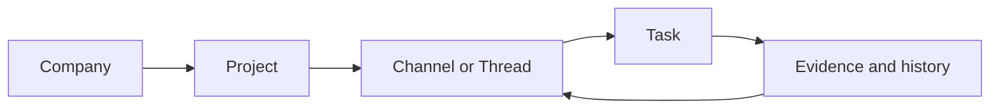

# Track web and mobile changes

Track now gives people one clear path from a Company to a Project, from a chat to a task, and from a task back to its source.

## What changed

- The web app now has a clearer Company and Project shell.
- Tasks, Channels, Threads, Evidence, and Memory share the same spacing, buttons, fields, focus states, and safe dialogs.
- The mobile app now has cleaner Home, Projects, Task Board, Task Detail, Evidence, chat, thread, and notification flows.
- The mobile bottom navigation is easier to read on Android, and the Project Task Board keeps its original header layout.
- The backend now uses priority-aware task indexes, so filtered task pages return the right tasks without breaking cursor pagination.
- Tests cover the new dialogs, labels, dates, toasts, mentions, tasks, threads, navigation, and mobile helpers.

## How the main flow works

Each step keeps its place and source. A person can move forward to do work, then move back to see why the work exists.

## Recorded verification

These results describe the original review. Run the repository gate for the current worktree; the counts below are not a current test report.

| Check | Result | Meaning |
|---|---:|---|
| Lint | 100% passed | Web, mobile, shared, and Convex code passed lint. |
| Type check | 100% passed | Backend and all app packages passed TypeScript checks. |
| Tests | 279 / 279 passed (100%) | Shared, web, mobile, and Convex tests are green. |
| Dependency audit | 0 known vulnerabilities | Production dependencies passed the audit. |
| Production build | Passed | Web client, server, Nitro output, and mobile build step completed. |

The original Android emulator review used demo data and covered Home, Projects, Project Task Board, Task Detail, and Evidence. Review screenshots and recordings are kept outside the source tree; automated browser evidence is retained as CI artifacts.

## Change map

| Area | Main result | Review value |
|---|---|---|
| Web | Shared Company, Project, task, thread, search, and evidence patterns | Easier desktop navigation and safer actions |
| Mobile | Consistent screens, cards, sheets, task board, and Android navigation | Easier phone use and clearer work context |
| Backend | Scoped task data, priority indexes, and cursor-safe filtering | Correct results as task lists grow |
| Tests and docs | Regression tests, audit notes, and design rules | Faster review and safer future changes |

## Limits

The original visual review did not establish exact Figma pixel parity because the connected Figma session did not expose the reference file for reliable inspection. Current layout and interaction behavior require a fresh application check.
